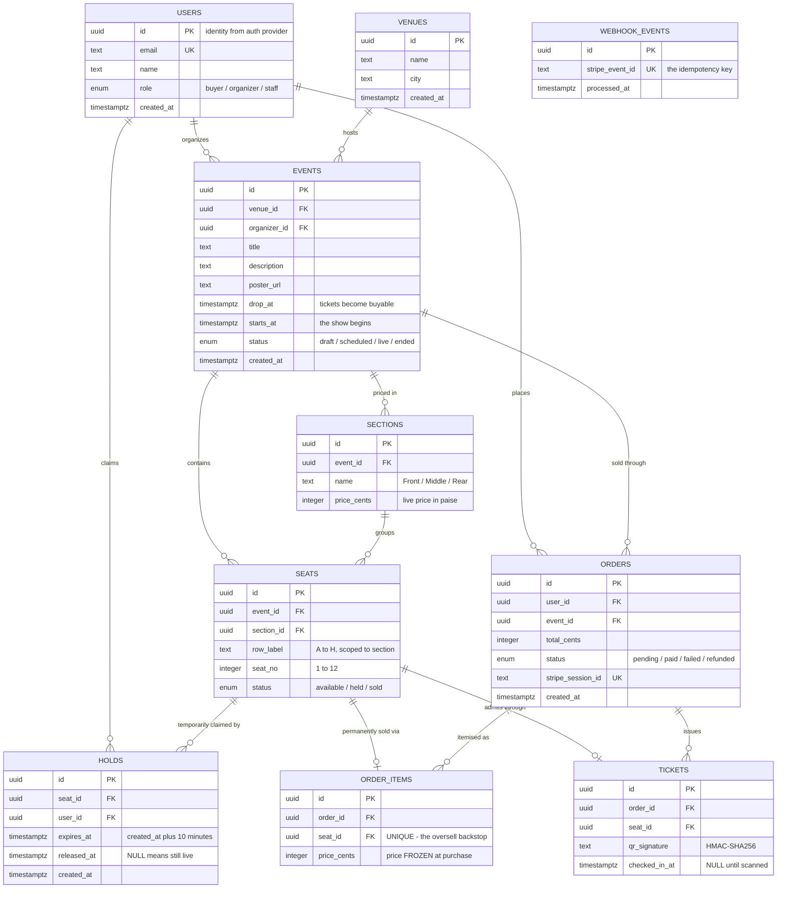
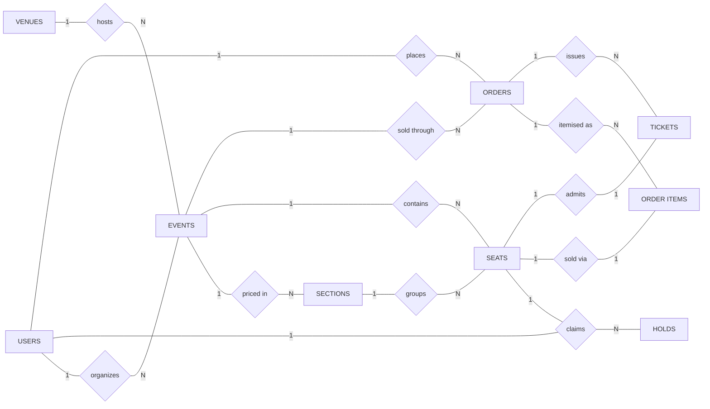

# RUSH — A High-Demand Ticket Drop Platform

## Database Systems Lab — Review 1 (Design Review)

| | |
|---|---|
| **Project title** | RUSH — a high-demand ticket drop platform |
| **Student** | Hardik Ahuja |
| **Registration number** | 24BCE2029 |
| **Review** | First Review — Design Review (10 Marks) |
| **Database** | PostgreSQL 17.6 (hosted on Supabase) |
| **Application stack** | Next.js 16, TypeScript, Drizzle ORM, Upstash Redis, Stripe |
| **Repository** | https://github.com/hardikahujaa/Rush |

---

## 1. Problem Definition and Objectives

### 1.1 Problem Definition

When tickets for a popular concert or match are released, tens of thousands of people
attempt to buy a few hundred seats within the same few seconds. This is not an ordinary
e-commerce workload. In a normal online store, two customers buying "the same" laptop is
perfectly fine — the shop simply decrements stock twice. A seat is different: **seat H-14
is a single physical object, and it can belong to exactly one person.**

This creates a class of failure that ordinary shopping systems never have to solve:

1. **Double-booking (overselling).** Two buyers click the same seat within milliseconds of
   each other. If the system checks availability and then writes the booking as two
   separate steps, both requests can pass the check before either writes, and both
   customers are told they succeeded. Two people arrive at the venue holding a valid
   ticket for one chair.

2. **Inventory locked up by abandoned carts.** A buyer must be given time to enter card
   details, so the seat has to be reserved before payment. But if a reservation is never
   cleaned up when the buyer walks away, a sold-out event can have hundreds of empty
   seats that nobody was allowed to buy.

3. **Asynchronous payment confirmation.** Payment gateways confirm a transaction by
   calling back to the application, and they deliberately **retry that callback** until
   they receive an acknowledgement. A system that simply issues tickets each time it is
   called will issue two or three sets of tickets for a single payment.

4. **No fair ordering under load.** Without an explicit queue, whoever has the fastest
   connection wins, and automated bots outperform every genuine customer.

The database is where these problems must actually be solved. Application code can be
deployed twice, run on many servers at once, or contain a bug; the database is the single
point through which every request must pass, and it is therefore the only place where a
guarantee can be made absolute.

### 1.2 Objectives

The RUSH system aims to:

1. Allow customers to register, log in, and browse events by venue, date and price tier.
2. Present a live seat map showing each seat as available, temporarily held, or sold.
3. Let a customer place a **temporary, time-limited hold** on up to four seats while they
   complete payment.
4. **Guarantee at the database level that a seat can never be held or sold twice**, even
   under heavy concurrent load.
5. Release expired holds automatically so abandoned carts return inventory to the pool.
6. Process payments through a secure external gateway and record orders, order items and
   issued tickets.
7. Handle repeated payment notifications **idempotently**, so one payment produces exactly
   one set of tickets.
8. Issue each ticket with a cryptographically signed QR code, and allow venue staff to
   check a ticket in exactly once at the gate.
9. Provide organizers with sales analytics: revenue, sell-through rate per section, sales
   over time, and hold-to-purchase conversion.
10. Queue users fairly during a high-demand release window.

---

## 2. Requirement Analysis and Database Design

### 2.1 Functional Requirements

The system should:

| # | Requirement |
|---|---|
| FR1 | Register and authenticate users, and assign each a role of `buyer`, `organizer` or `staff`. |
| FR2 | Allow an organizer to create venues and events, with a scheduled release time (`drop_at`) and an event start time (`starts_at`). |
| FR3 | Allow an event to be divided into priced sections (Front / Middle / Rear), and generate individual seats within each section by row and number. |
| FR4 | Display all events with venue, date, price range and the count of seats still available. |
| FR5 | Display a seat map for an event showing the live status of every seat. |
| FR6 | Allow a buyer to hold up to **four** seats at once for a fixed window of **ten minutes**. |
| FR7 | Reject a hold request if any requested seat is already sold or already held by another user. |
| FR8 | Treat a hold whose expiry time has passed as no longer valid, returning the seat to the available pool. |
| FR9 | Allow a buyer to release held seats manually before the timer expires. |
| FR10 | Create an order with line items when the buyer proceeds to checkout, and compute the total on the server from the section price. |
| FR11 | Mark an order as paid, mark its seats as sold, and issue one ticket per seat when payment is confirmed. |
| FR12 | Ignore duplicate payment confirmations for an already-processed transaction. |
| FR13 | Generate a signed QR code for each ticket and allow staff to check it in exactly once, reporting VALID, ALREADY USED, or INVALID. |
| FR14 | Provide organizers with revenue, sell-through and conversion analytics per event. |
| FR15 | Maintain a complete order and ticket history for every user. |

### 2.2 Non-Functional Requirements

| # | Requirement |
|---|---|
| NFR1 | **Correctness under concurrency.** No seat may ever appear on more than one live hold or more than one paid order, regardless of request volume. This is the system's primary quality attribute. |
| NFR2 | **Data integrity independent of application code.** The no-oversell guarantee must be enforced by database constraints, so that a bug in the application cannot violate it. |
| NFR3 | **Financial accuracy.** All monetary values stored as integers (paise), never floating point, so that repeated summation cannot drift. |
| NFR4 | **Auditability.** Historical records (order prices, released holds, processed payment events) are retained rather than overwritten or deleted. |
| NFR5 | **Security.** Passwords are never stored by the application; card details never touch our servers; QR codes are signed so they cannot be forged; users may only read their own orders and tickets. |
| NFR6 | **Performance.** Seat-map and availability queries must remain fast on the largest table in the database, supported by appropriate indexes. |
| NFR7 | **Time correctness.** All timestamps stored with time zone, since release times, hold expiry and check-in are meaningless without an unambiguous instant. |
| NFR8 | **Scalability.** The design must tolerate many short-lived application instances connecting concurrently. |
| NFR9 | **Reliability.** Expiry of holds must not depend on a scheduled background job running successfully. |

### 2.3 Entities Identified

The database stores information about:

| Entity | Purpose |
|---|---|
| **Users** | Everyone who interacts with the system, distinguished by role. |
| **Venues** | Physical locations where events take place. |
| **Events** | A single show at a venue, with a release time and a status. |
| **Sections** | A priced tier within an event (Front, Middle, Rear). |
| **Seats** | An individual physical seat, identified by section, row and number. |
| **Holds** | A temporary, expiring claim by one user on one seat. |
| **Orders** | A purchase transaction made by a user for an event. |
| **Order Items** | The individual seats belonging to an order, with the price paid. |
| **Tickets** | The signed admission credential issued for a purchased seat. |
| **Webhook Events** | A log of payment notifications already processed, used to prevent duplicates. |

### 2.4 Relationships Identified

- One **Venue** hosts many **Events**.
- One **User** (organizer) organizes many **Events**.
- One **Event** contains many **Sections**, and many **Seats**.
- One **Section** groups many **Seats**; every Seat belongs to exactly one Section.
- One **User** places many **Holds**; one **Seat** may have many Holds over time, but at
  most one *live* Hold at any instant.
- One **User** places many **Orders**; one **Event** is sold through many Orders.
- One **Order** contains many **Order Items**; one **Seat** appears in at most one Order
  Item, ever.
- One **Order** issues many **Tickets**; one **Seat** has at most one Ticket.

### 2.5 Assumptions and Design Constraints

1. **Seating is fully reserved.** Every attendee holds a specific numbered seat; there is
   no general-admission or standing capacity.
2. **Currency is INR**, stored in paise as an integer. ₹4,999 is stored as `499900`.
3. **A hold lasts ten minutes** and covers **at most four seats** per request.
4. **Identity is delegated.** Authentication is handled by an external provider; the
   `users` table mirrors the authenticated identity and adds the application role. No
   password is stored in this database.
5. **Payments are delegated.** Card data never reaches this system; only the payment
   session identifier and resulting status are stored.
6. **A seat's `status` column is a cached value, not the source of truth.** The
   authoritative answer to "is this seat taken?" is the presence of a live unexpired row
   in `holds`, or any row in `order_items`.
7. Reference data (`venues`, `events`) uses `RESTRICT` on delete so that records tied to
   money cannot be destroyed accidentally; purely structural children (`sections`,
   `seats`) cascade.

---

## 3. Database Model / Design (ER Diagram)

### 3.1 Entity Relationship Diagram — Crow's Foot Notation

This diagram shows every entity with its full attribute list, primary keys (PK), foreign
keys (FK) and unique keys (UK).



> **Note on `WEBHOOK_EVENTS`.** This entity intentionally has no relationships. It is not
> business data — it is a ledger recording which payment notifications have already been
> acted upon, and it must remain writable even when the payment it refers to is unknown to
> the system.

### 3.2 Entity Relationship Diagram — Chen Notation

The same model in classical Chen notation, showing entities as rectangles, relationships
as diamonds, and cardinality on each edge. Attributes are given in full in the data
dictionary (Section 3.4) rather than as ellipses here, because ten entities with
forty-five attributes would be unreadable as a single attribute-bearing diagram.



### 3.3 Relationship and Cardinality Summary

| Parent | Relationship | Child | Cardinality | Participation | On Delete |
|---|---|---|---|---|---|
| VENUES | hosts | EVENTS | 1 : N | Total on child | RESTRICT |
| USERS | organizes | EVENTS | 1 : N | Total on child | RESTRICT |
| EVENTS | priced in | SECTIONS | 1 : N | Total on child | CASCADE |
| EVENTS | contains | SEATS | 1 : N | Total on child | CASCADE |
| SECTIONS | groups | SEATS | 1 : N | Total on child | CASCADE |
| SEATS | claimed by | HOLDS | 1 : N over time, **1 : 1 live** | Partial | CASCADE |
| USERS | claims | HOLDS | 1 : N | Total on child | CASCADE |
| USERS | places | ORDERS | 1 : N | Total on child | RESTRICT |
| EVENTS | sold through | ORDERS | 1 : N | Total on child | RESTRICT |
| ORDERS | itemised as | ORDER_ITEMS | 1 : N | Total on child | CASCADE |
| SEATS | sold via | ORDER_ITEMS | **1 : 0..1** | Partial | RESTRICT |
| ORDERS | issues | TICKETS | 1 : N | Total on child | CASCADE |
| SEATS | admits through | TICKETS | **1 : 0..1** | Partial | RESTRICT |

The two rows in bold are where the business rule lives. A seat may participate in many
holds across its lifetime but in at most one *live* hold, and in at most one order item
ever. Section 3.5 shows how each is enforced.

### 3.4 Data Dictionary

**USERS** — every person who interacts with the system.

| Column | Type | Constraint | Description |
|---|---|---|---|
| id | UUID | PK | Identity issued by the authentication provider |
| email | TEXT | NOT NULL, UNIQUE | Login address |
| name | TEXT | NULL | Display name |
| role | ENUM | NOT NULL, DEFAULT 'buyer' | buyer / organizer / staff |
| created_at | TIMESTAMPTZ | NOT NULL, DEFAULT now() | Registration time |

**VENUES** — physical locations.

| Column | Type | Constraint | Description |
|---|---|---|---|
| id | UUID | PK | |
| name | TEXT | NOT NULL | e.g. Nehru Indoor Stadium |
| city | TEXT | NOT NULL | e.g. Chennai |
| created_at | TIMESTAMPTZ | NOT NULL | |

**EVENTS** — a single show.

| Column | Type | Constraint | Description |
|---|---|---|---|
| id | UUID | PK | |
| venue_id | UUID | FK → venues.id, RESTRICT | Where it is held |
| organizer_id | UUID | FK → users.id, RESTRICT | Who runs it |
| title | TEXT | NOT NULL | |
| description | TEXT | NULL | |
| poster_url | TEXT | NULL | |
| drop_at | TIMESTAMPTZ | NOT NULL | When tickets become buyable |
| starts_at | TIMESTAMPTZ | NOT NULL | When the show begins |
| status | ENUM | NOT NULL, DEFAULT 'draft' | draft / scheduled / live / ended |
| created_at | TIMESTAMPTZ | NOT NULL | |

**SECTIONS** — a priced tier within an event.

| Column | Type | Constraint | Description |
|---|---|---|---|
| id | UUID | PK | |
| event_id | UUID | FK → events.id, CASCADE | |
| name | TEXT | NOT NULL, UNIQUE per event | Front / Middle / Rear |
| price_cents | INTEGER | NOT NULL | Live price in paise |

**SEATS** — an individual physical seat.

| Column | Type | Constraint | Description |
|---|---|---|---|
| id | UUID | PK | |
| event_id | UUID | FK → events.id, CASCADE | |
| section_id | UUID | FK → sections.id, CASCADE | Determines the price |
| row_label | TEXT | NOT NULL | A–H, unique within its section |
| seat_no | INTEGER | NOT NULL | 1–12 |
| status | ENUM | NOT NULL, DEFAULT 'available' | available / held / sold (cached) |

**HOLDS** — a temporary claim on one seat.

| Column | Type | Constraint | Description |
|---|---|---|---|
| id | UUID | PK | |
| seat_id | UUID | FK → seats.id, CASCADE | |
| user_id | UUID | FK → users.id, CASCADE | |
| expires_at | TIMESTAMPTZ | NOT NULL | Creation time plus ten minutes |
| released_at | TIMESTAMPTZ | NULL | NULL means the hold is still live |
| created_at | TIMESTAMPTZ | NOT NULL | |

**ORDERS** — a purchase transaction.

| Column | Type | Constraint | Description |
|---|---|---|---|
| id | UUID | PK | |
| user_id | UUID | FK → users.id, RESTRICT | |
| event_id | UUID | FK → events.id, RESTRICT | |
| total_cents | INTEGER | NOT NULL | Computed server-side |
| status | ENUM | NOT NULL, DEFAULT 'pending' | pending / paid / failed / refunded |
| stripe_session_id | TEXT | UNIQUE, NULL | Payment gateway session |
| created_at | TIMESTAMPTZ | NOT NULL | |

**ORDER_ITEMS** — one seat on one order.

| Column | Type | Constraint | Description |
|---|---|---|---|
| id | UUID | PK | |
| order_id | UUID | FK → orders.id, CASCADE | |
| seat_id | UUID | FK → seats.id, RESTRICT, **UNIQUE** | A seat sells once, ever |
| price_cents | INTEGER | NOT NULL | Price frozen at purchase time |

**TICKETS** — the admission credential.

| Column | Type | Constraint | Description |
|---|---|---|---|
| id | UUID | PK | |
| order_id | UUID | FK → orders.id, CASCADE | |
| seat_id | UUID | FK → seats.id, RESTRICT, UNIQUE | |
| qr_signature | TEXT | NOT NULL | HMAC-SHA256 of ticket, order and seat ids |
| checked_in_at | TIMESTAMPTZ | NULL | Set exactly once at the gate |

**WEBHOOK_EVENTS** — the idempotency ledger.

| Column | Type | Constraint | Description |
|---|---|---|---|
| id | UUID | PK | |
| stripe_event_id | TEXT | NOT NULL, UNIQUE | Gateway's event identifier |
| processed_at | TIMESTAMPTZ | NOT NULL | When it was handled |

### 3.5 Integrity Constraints Enforcing the Business Rules

Three constraints carry the correctness guarantee. None of them depends on the
application behaving correctly.

**(a) A seat can have at most one live hold — partial unique index**

```sql
CREATE UNIQUE INDEX one_live_hold_per_seat
    ON holds (seat_id)
    WHERE released_at IS NULL;
```

The `WHERE` clause is what makes this work. A plain unique index on `seat_id` would mean a
seat could only ever be held once in its entire lifetime. A **partial** index applies
uniqueness only to rows satisfying the condition, so a seat may accumulate any number of
*released* holds in its history while never having two *live* ones at the same instant. If
two concurrent requests both attempt to hold seat H-14, PostgreSQL accepts the first and
rejects the second with a unique-violation error.

**(b) A seat can be sold at most once — unique index**

```sql
CREATE UNIQUE INDEX one_sold_seat ON order_items (seat_id);
```

The final backstop. Even if a hold somehow leaked and two buyers reached the payment
gateway, only one of their confirmations can commit; the other transaction fails here and
is refunded.

**(c) A payment notification is acted on at most once — unique key**

```sql
ALTER TABLE webhook_events ADD CONSTRAINT webhook_events_stripe_event_id_unique
    UNIQUE (stripe_event_id);
```

Payment gateways retry notifications until acknowledged. Recording the identifier of every
notification already processed turns "have I seen this before?" into a question the
database answers atomically, rather than one the application tries to reason about.

**Supporting uniqueness constraints**

```sql
CREATE UNIQUE INDEX seats_unique_position
    ON seats (event_id, section_id, row_label, seat_no);
CREATE UNIQUE INDEX sections_event_name ON sections (event_id, name);
CREATE UNIQUE INDEX tickets_seat_unique ON tickets (seat_id);
```

Note that `seats_unique_position` includes `section_id`. Row labels are scoped to their
section, exactly as in a real venue — Front row A seat 1 and Middle row A seat 1 are
different chairs.

### 3.6 Indexes for Performance

| Index | Table | Columns | Purpose |
|---|---|---|---|
| `seats_event_status` | seats | (event_id, status) | Seat map query on the largest table |
| `events_status_drop_at` | events | (status, drop_at) | Event listing filtered by status, ordered by release time |
| `holds_user_expires` | holds | (user_id, expires_at) | "Which of my seats are still held?" for the countdown |
| `orders_user_created` | orders | (user_id, created_at) | A user's order history, newest first |

### 3.7 Normalisation Analysis

The schema is in **Third Normal Form**, with one deliberate and documented exception.

- **1NF** — every attribute is atomic. A multi-seat purchase is represented as several
  `order_items` rows, not as a list inside one order row.
- **2NF** — every table has a single-column surrogate primary key, so no non-key attribute
  can depend on part of a composite key.
- **3NF** — no transitive dependencies. Price is the illustrative case: a seat's price is
  determined by its section, so `price_cents` lives on `sections` and a seat merely
  references it. Storing the price on all ninety-six seats of a section would mean a price
  change required ninety-six updates that must all succeed; any that silently failed would
  leave two seats in the same row selling at different prices with no way to tell which was
  correct.

**The deliberate exception.** `order_items.price_cents` duplicates the section price at the
moment of purchase. This is a considered denormalisation, not an oversight. An order item
is a **financial record**. If a receipt read its price through a join to `sections`, then
an organizer raising the Front tier from ₹4,999 to ₹5,999 next week would retroactively
rewrite what every past customer appears to have paid. Copying the value freezes history.

The governing principle: **point at live data, copy historical facts.**

A second, similar case is `seats.status`, which is derivable from `holds` and
`order_items`. It is retained as a cached value so that rendering a 288-seat map does not
require joining two tables, but it is never consulted when deciding whether a seat may be
sold.

### 3.8 Scale of the Seeded Dataset

| Quantity | Value |
|---|---|
| Venues | 1 |
| Events | 3 (one live, one scheduled to release shortly, one completed) |
| Sections per event | 3 — Front ₹4,999 · Middle ₹2,499 · Rear ₹999 |
| Seats per section | 96 (rows A–H × 12 seats) |
| Seats per event | 288 |
| Total seats | 864 |
| Seats sold | 345, through 142 orders with matching tickets |
| Revenue represented | ₹9,73,655 |

---

## 4. Summary

RUSH is designed around a single hard requirement: **a seat belongs to exactly one
person.** Everything in the schema follows from taking that seriously.

Rather than trusting application code to check availability before writing, the design
places the guarantee in the database itself, using a partial unique index for temporary
holds and a unique index for completed sales. Expiry of holds is handled by evaluating
`expires_at` inside the query rather than by a scheduled cleanup job, so no seat is ever
stranded because a background task failed to run. Financial values are stored as integers
and frozen at the point of purchase, so historical records cannot drift or be rewritten.

The result is a model in which the correctness of the system does not depend on the
correctness of the code that sits above it.
