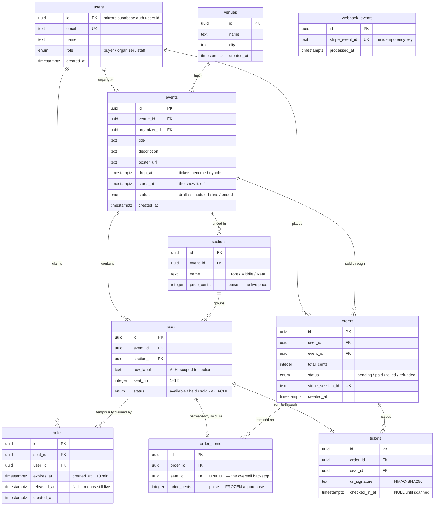

# RUSH — entity relationship diagram

Generated from [`src/db/schema.ts`](../src/db/schema.ts). If you change the schema, change this too.

`webhook_events` has no foreign keys and stands apart on purpose — it is not
business data. It is a ledger of which Stripe deliveries we have already acted
on, and it must be writable even when everything else about an event is
unfamiliar.

## Design decisions

**A seat's life is modelled as three separate facts, not one column.** `seats.status`
looks like it answers "is this taken?", but it is only a cache so the seat map can be
drawn without joins. The real answers live elsewhere: a live row in `holds` means
temporarily claimed, a row in `order_items` means permanently sold. Any query that
decides whether a seat may be *sold* consults those, never the cached status. This is
what makes lazy expiry possible — a hold whose `expires_at` has passed is simply not
counted, with no cron job needed to clean it up.

**Price is stored twice, deliberately, and the two copies mean different things.**
`sections.price_cents` is the live price and can be changed by the organizer at any time.
`order_items.price_cents` is a copy taken at the moment of purchase and never changes
again. Reading a receipt through a join to `sections` would silently rewrite history
every time a price moved. The rule: point at live data, copy historical facts.

**Three database-level constraints carry the no-oversell guarantee,** and none of them
depends on application code being correct:

| Constraint | Table | What it makes impossible |
|---|---|---|
| `one_live_hold_per_seat` | `holds` | Two people holding one seat at the same moment. Partial unique index on `seat_id WHERE released_at IS NULL`, so a seat may accumulate any number of *past* holds but only ever one live one. |
| `one_sold_seat` | `order_items` | One seat appearing on two orders, ever. The last line of defence if a hold somehow leaks. |
| `stripe_event_id` unique | `webhook_events` | Stripe's automatic retries issuing a second set of tickets for a single payment. |

**Every foreign key states what happens on delete.** Structural children cascade —
deleting an event removes its sections and seats, because they have no meaning without
it. Anything touching money uses `restrict` instead: `order_items` will physically
refuse to let you delete a seat that somebody paid for. Financial records should be hard
to destroy by accident.

**`users.id` is not generated by this database.** Supabase Auth owns identity and issues
the uuid at signup; our `users` row copies it. That keeps one identity across the auth
system and the business tables, so `orders.user_id` and the logged-in session are
guaranteed to refer to the same person.
